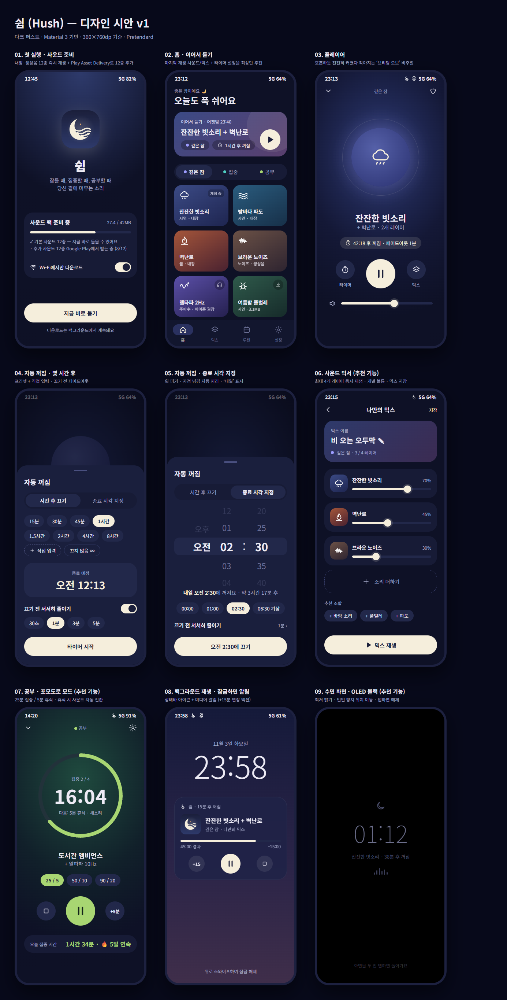

# 쉼 (Hush) — 안드로이드 화이트 노이즈 & 수면 사운드 앱

> **"잠들 때, 집중할 때, 공부할 때 당신 곁에 머무는 소리"**  
> 쉼(Hush)은 불면과 소음으로부터 벗어나 깊은 휴식과 몰입을 돕는 안드로이드 화이트 노이즈 앱입니다.



---

## ✨ 주요 기능

1. **3대 분류 25종 사운드 라인업**:
   - 🌙 **깊은 잠**: 잔잔한 빗소리, 밤바다 파도, 폭풍과 천둥, 벽난로, 브라운 노이즈, 텐트 위 빗소리, 여름밤 풀벌레, 델타파 2Hz, 432Hz 드론
   - 🎯 **집중**: 화이트 노이즈, 핑크 노이즈, 숲속 계곡, 폭포, 모닥불, 바람 소리, 카페 앰비언스, 베타파 18Hz
   - 📖 **공부**: 도서관 앰비언스, 창가 빗소리, 잔잔한 시냇물, 장작 난로, 산들바람 숲, 그린 노이즈, 알파파 10Hz, 40Hz 감마
2. **이어서 듣기 (Instant Resume)**:
   - 시작할 때 가장 마지막에 들었던 사운드/믹스와 볼륨, 1시간 타이머를 홈 최상단에서 기억하여 1탭으로 즉시 재생.
3. **호흡하는 브리딩 오브 (Breathing Orb)**:
   - 플레이어 화면에서 4초 들숨, 6초 날숨 주기로 은은하게 박동하는 앰비언트 글로우 비주얼.
4. **스마트 자동 꺼짐 타이머**:
   - **시간 후 끄기** (15분 ~ 8시간 프리셋 + 직접 입력)
   - **종료 시각 지정** (시:분 휠 피커, 자정 넘김 시 '내일' 자동 계산)
   - **로그 감쇄 페이드아웃** (끄기 전 30초~5분 동안 볼륨을 서서히 줄여 수면 방해 방지)
   - 알림 및 플레이어에서 **+15분 즉시 연장**
5. **백그라운드 미디어 재생 & 상태바 전용 아이콘**:
   - Android Media3 `MediaSessionService` 기반의 안정적인 포그라운드 재생
   - 상태바 전용 흰색 단색 벡터 아이콘 2종 자동 전환:
     - 일반 재생 중: `ic_stat_playing` (초승달 + 물결)
     - 자동 꺼짐 타이머 동작 중: `ic_stat_timer` (시계 + 물결)
   - 헤드폰/블루투스 탈착 시 자동 일시정지 (`ACTION_AUDIO_BECOMING_NOISY`)
6. **4채널 사운드 믹서**:
   - 최대 4개 사운드를 동시에 재생하며 개별 볼륨 조절 및 나만의 믹스 저장/불러오기.
7. **공부 · 포모도로 모드**:
   - 25/5, 50/10 원형 진행 링, 집중/휴식 사운드 자동 전환, 오늘의 누적 집중 시간 카운트.
8. **순수 OLED 블랙 수면 화면**:
   - `#000000` 배경, 은은한 저조도 시계, 60초 주기 번인 방지 미세 이동, 더블 탭 해제.
9. **완전 무료 & 무서버**:
   - 어떠한 광고나 인앱 결제 없이 100% 무료.

---

## 🛠️ 기술 스택

- **UI**: Kotlin, Jetpack Compose, Material 3, Navigation Compose
- **Architecture**: Single Activity (MVVM), StateFlow, State Hoisting
- **Audio Engine**: AndroidX Media3 (ExoPlayer 1.5.1, MediaSessionService), `AudioTrack` (8종 실시간 주파수/노이즈 절차적 합성기)
- **Data & Storage**: Jetpack DataStore Preferences
- **Design System**: 다크 퍼스트 팔레트 (DarkBg `#0E1126`, MoonPrimary `#F5EEDC`), Adaptive Icon, 상태바 벡터 리소스
- **Target SDK**: Android 15 (API 35), Min SDK: Android 8.0 (API 26)

---

## 🚀 빌드 및 실행

```bash
# 디버그 APK 빌드
./gradlew assembleDebug

# 연결된 디바이스에 설치
./gradlew installDebug

# 유닛 테스트 실행
./gradlew testDebugUnitTest
```

---

## 📄 라이선스 및 음원 출처

본 프로젝트의 소스 코드는 MIT 라이선스를 따르며, 수록된 모든 음원은 CC0 / Public Domain 공개 라이선스 및 자체 절차적 합성기(`ProceduralAudioGenerator`)를 통해 제공됩니다. 자세한 출처는 앱 내 '설정 > 사운드 출처' 화면을 참조하세요.
