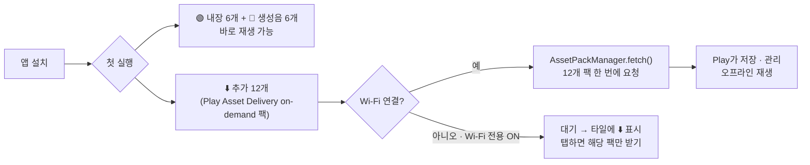
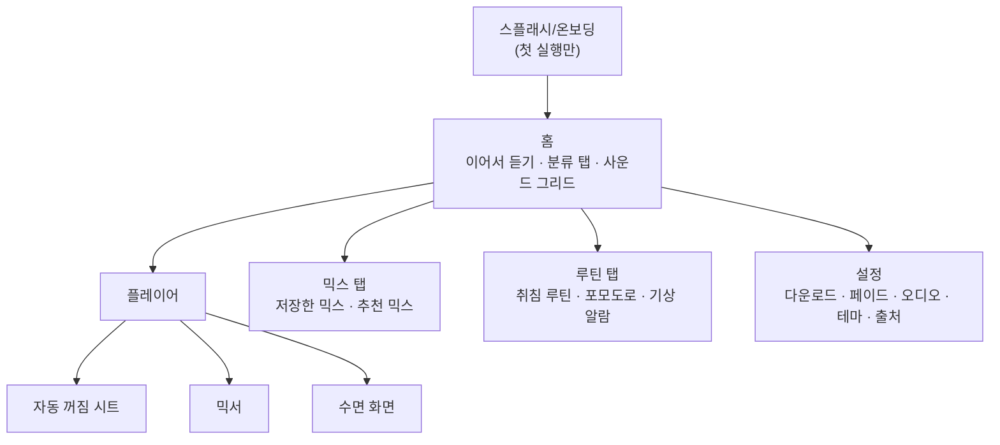
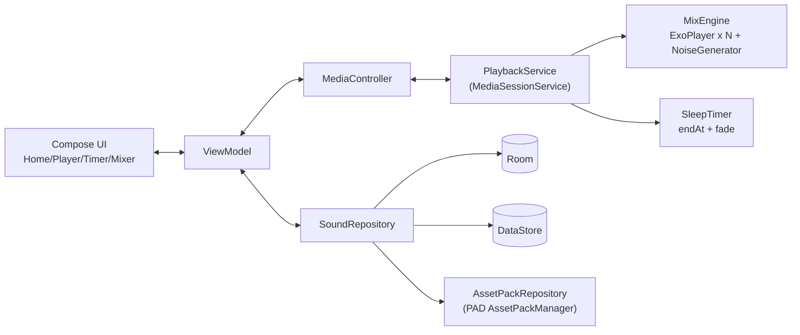

# 쉼 (Hush) — 안드로이드 화이트 노이즈 앱 기획서 v1.1

> **쉼 (Hush)**: 잠잘 때, 집중할 때, 공부할 때 듣는 소리.

### ✅ 확정 사항 (2026-11-03)
| 항목 | 결정 |
|---|---|
| 앱 이름 | **쉼 (Hush)** |
| 추가 사운드 배포 | **Google Play Asset Delivery만 사용 (자체 서버 없음)** |
| 수익 모델 | **완전 무료**: 유료 기능·구독·광고 없음 |

## 1. 제품 개요

| 항목 | 내용 |
|---|---|
| 목표 | 잠들기·집중·공부 상황에 맞는 소리를 **한 번 탭으로** 재생하고, **화면을 끈 채** 원하는 시간까지 틀어 두기 |
| 대상 | 잠들기 어려운 사람, 재택근무·카페 작업자, 수험생/학생, 신생아 부모(2차) |
| 플랫폼 | Android 8.0 (API 26) 이상, 타깃 API 35 |
| 핵심 가치 | ① 빠름 (실행 → 재생까지 1탭) ② 오프라인 동작 ③ 밤에 보기 편한 어두운 화면 ④ 끊김 없는 반복 재생 |

## 2. 요구사항 반영

| # | 요구사항 | 반영 방식 |
|---|---|---|
| 1 | 깊은 잠 / 집중 / 공부 3분류, 분류마다 5~10개 | 분류마다 **8개씩, 총 24개** (아래 §3) |
| 2 | 내장 또는 첫 실행 때 다운로드 | **섞어서 씀**: 핵심 6개는 앱에 내장, 생성음 6개는 앱이 실시간으로 만듦(0MB), 나머지 12개는 첫 실행 때 받음 (§4) |
| 3 | 자연·불·주파수 소리 | 자연 13 / 불 4 / 노이즈·주파수 7 |
| 4 | 자동 꺼짐 (몇 시간 후 / 종료 시각) | 두 가지 방식 + **페이드아웃** + 알림에서 **+15분 연장** (§5.3) |
| 5 | 시작할 때 마지막 소리 추천 | 홈 맨 위에 **“이어서 듣기”** 카드. 사운드·믹스·볼륨·타이머 설정까지 기억 (§5.2) |
| 6 | 앱 아이콘 | 초승달이 소리 물결로 풀려 나가는 모양 (디자인 가이드 §6) |
| 7 | 백그라운드 재생 + 아이콘 | Media3 `MediaSessionService` 포그라운드 서비스 + 상태바 아이콘 2종 (재생 중 / 타이머 동작 중) |

## 3. 사운드 라인업 (24개)

범례: 🟢 내장(APK) · 🔵 생성음(실시간 합성, 0MB) · ⬇️ 첫 실행 때 다운로드 · 🎧 이어폰 권장

### 🌙 깊은 잠 (8)
| 사운드 | 종류 | 제공 | 설명 |
|---|---|---|---|
| 잔잔한 빗소리 | 자연 | 🟢 | 가장 많이 쓰일 대표 사운드 |
| 밤바다 파도 | 자연 | 🟢 | 느린 파도 주기 (약 8~10초) |
| 벽난로 | 불 | 🟢 | 장작이 타닥거리는 소리 |
| 브라운 노이즈 | 노이즈 | 🔵 | 낮은 음 위주의 묵직한 노이즈 |
| 텐트 위 빗소리 | 자연 | ⬇️ | 천막에 떨어지는 빗소리 |
| 여름밤 풀벌레 | 자연 | ⬇️ | 귀뚜라미, 먼 개구리 소리 |
| 델타파 2Hz | 주파수 | 🔵🎧 | 바이노럴 비트 (깊은 잠) |
| 432Hz 드론 | 주파수 | 🔵 | 부드러운 저음이 계속 이어짐 |

### 🎯 집중 (8)
| 사운드 | 종류 | 제공 | 설명 |
|---|---|---|---|
| 화이트 노이즈 | 노이즈 | 🔵 | 주변 소음을 가려 줌 |
| 핑크 노이즈 | 노이즈 | 🔵 | 화이트 노이즈보다 부드러움 |
| 숲속 계곡 | 자연 | 🟢 | 졸졸 흐르는 물 + 새소리 조금 |
| 폭포 | 자연 | ⬇️ | 넓고 꽉 찬 소리 |
| 모닥불 | 불 | 🟢 | 야외, 바람 섞인 불소리 |
| 바람 소리 | 자연 | ⬇️ | 고원의 바람 |
| 카페 앰비언스 | 생활 | ⬇️ | 웅성거림, 잔 부딪히는 소리 |
| 베타파 18Hz | 주파수 | 🔵🎧 | 바이노럴 비트 (각성·집중) |

### 📖 공부 (8)
| 사운드 | 종류 | 제공 | 설명 |
|---|---|---|---|
| 도서관 앰비언스 | 생활 | ⬇️ | 책장 넘기는 소리, 연필 소리 |
| 창가 빗소리 | 자연 | ⬇️ | 유리창에 부딪히는 빗소리 |
| 잔잔한 시냇물 | 자연 | ⬇️ | 계곡보다 조용함 |
| 장작 난로 | 불 | ⬇️ | 작은 무쇠 난로 |
| 산들바람 숲 | 자연 | ⬇️ | 나뭇잎 스치는 소리 |
| 그린 노이즈 | 노이즈 | ⬇️ | 중간 음역대 중심, 자연스러운 느낌 |
| 알파파 10Hz | 주파수 | 🔵🎧 | 바이노럴 비트 (차분한 집중) |
| 40Hz 감마 | 주파수 | 🔵 | 등시성(isochronic) 톤 |

> [!NOTE]
> 한 사운드를 여러 분류에 넣을 수도 있습니다 (예: 빗소리 → 깊은 잠·공부). 데이터 모델은 다대다(N:M) 태그 방식으로 만듭니다. 주파수 사운드는 **의학적 효과를 내세우지 않는** 문구로 안내합니다 (Play 정책 대응).

## 4. 사운드 제공 방식 (내장 + 다운로드)

| 항목 | 정책 |
|---|---|
| 파일 형식 | **Ogg Opus 96~128kbps 스테레오**, 끊김 없이 반복되도록 편집한 3~5분 루프 (약 2.5~4MB/개) |
| 용량 | 기본 모듈 내장 약 18MB / on-demand 팩 합계 약 42MB / 생성음 0MB |
| 배포 방식 | **Play Asset Delivery (PAD)**. 앱 번들(AAB)에 팩을 같이 올리면 Google Play가 호스팅함 → **서버·CDN 비용 0원** |
| 팩 구성 | **사운드 1개 = on-demand 팩 1개** (예: `pack_tent_rain`, `pack_library`). 타일에서 사운드를 하나만 받을 수 있음 (팩은 최대 100개까지 가능하므로 확장 여유 충분) |
| 왜 on-demand인가 | `fast-follow`는 설치 직후 Play가 자동으로 받아서 앱이 **Wi-Fi 전용** 설정을 지킬 수 없음 → 언제 받을지 앱이 정하는 `on-demand` 사용 |
| 다운로드 흐름 | 첫 실행 때 Wi-Fi면 12개를 한 번에 `fetch` / 모바일 데이터면 대기하다가 Wi-Fi가 연결되면 자동으로 받음 (`ConnectivityManager` 콜백) / 사용자가 타일을 탭하면 바로 받음 |
| 상태 처리 | `AssetPackState`를 Flow로 받아 타일에 진행률 링 표시. `WAITING_FOR_WIFI`면 `showConfirmationDialog()`, `FAILED`면 ‘다시 받기’ 표시 |
| 버전 관리 | 앱을 업데이트하면 Play가 바뀐 팩만 다시 받음 → 따로 만든 매니페스트나 해시 검증이 필요 없음 |
| 저장 공간 | 설정 > ‘다운로드한 사운드’에서 팩마다 용량을 보고 삭제(`removePack`) 가능 |
| 음원 출처 | 직접 녹음 또는 CC0(Freesound 등) / 상업용 라이선스. **출처 목록을 앱 안에 표시** |

> [!IMPORTANT]
> 사운드를 새로 추가하려면 **앱을 업데이트해야** 합니다 (서버가 없으므로). 분기마다 ‘시즌 사운드’ 업데이트를 내는 운영 방식을 권장합니다.

> [!TIP]
> 화이트·핑크·브라운 노이즈와 바이노럴 비트는 `AudioTrack`으로 **실시간 생성**합니다. 용량이 0이고, 반복 이음새가 아예 없어 품질도 가장 좋습니다.

## 5. 핵심 기능 상세

### 5.1 정보 구조 (IA)

### 5.2 처음 시작할 때: 마지막 소리 추천
- **저장할 정보**: 마지막으로 재생한 사운드 ID(또는 믹스 ID), 레이어별 볼륨, 분류, 타이머 방식·값, 페이드 설정, 재생한 시각
- **저장 시점**: 재생이 30초 넘게 이어졌을 때만 기록 (잘못 탭한 것은 무시). 저장 위치는 Jetpack **DataStore**
- **화면에 보여 주는 방식**
  - 홈 맨 위 **“이어서 듣기” 카드**: 사운드 이름, 분류 칩, ‘지난번 1시간 타이머’, ▶ 버튼
  - ▶를 누르면 **지난번 타이머까지 그대로 다시 켬** (설정에서 끌 수 있음)
  - 시간대가 맞지 않으면 보조 추천을 함께 표시: 예) 낮 2시에 실행했는데 마지막 소리가 ‘깊은 잠’이면 → 아래에 “오후엔 이런 소리 어때요? 도서관 앰비언스”
- **재생 기록이 없을 때 (첫 실행)**: 시간대로 추천 (22~05시 깊은 잠 / 09~18시 집중 / 그 밖의 시간 공부)
- **추가 진입점**: 앱 바로가기(아이콘 길게 누르기) “마지막 소리 재생”, 위젯, 빠른 설정 타일

### 5.3 자동 꺼짐 타이머
| 방식 | 내용 |
|---|---|
| 시간 후 끄기 | 프리셋 15·30·45분, 1·1.5·2·4·8시간 + 직접 입력 (최대 12시간) |
| 종료 시각 지정 | 휠 피커로 시:분 선택. 지금보다 이른 시각이면 **‘내일’**로 자동 처리하고 “약 3시간 17분 후” 함께 표시 |
| 끄지 않음 | 무한 재생 (∞) |
| 페이드아웃 | 끄기 전 30초 / 1분 / 3분 / 5분 동안 볼륨을 서서히 줄임 (기본 1분, 로그 곡선) |
| 연장 | 알림·플레이어에서 **+15분** |
| 종료 후 동작 | 재생 정지 → 서비스 종료 → (옵션) 수면 화면 해제 |

- **구현**: 서비스 안에서 남은 시간이 아니라 **종료 시각(epoch)**을 기준으로 계산 → Doze 모드나 프로세스 재시작에도 정확함. 시스템 시간대가 바뀌면 다시 계산
- 남은 시간은 플레이어 칩, 알림 subtitle, 상태바 아이콘(⏱ 변형)에 표시

### 5.4 백그라운드 재생
- **Media3 (ExoPlayer) + `MediaSessionService`** → 포그라운드 서비스 (`foregroundServiceType="mediaPlayback"`)
- 권한: `FOREGROUND_SERVICE`, `FOREGROUND_SERVICE_MEDIA_PLAYBACK`(A14+), `POST_NOTIFICATIONS`(A13+, 첫 재생 때 요청), `WAKE_LOCK`
- 미디어 알림: 재생/일시정지, **+15분**, 정지. 잠금화면·블루투스·Wear OS 컨트롤 자동 지원
- **오디오 포커스**: 전화가 오면 일시정지했다가 끊으면 다시 재생 / 다른 앱 소리가 날 때 볼륨 줄이기(ducking)는 설정으로 선택
- 이어폰을 빼면 일시정지 (`ACTION_AUDIO_BECOMING_NOISY`)
- 끊김 없는 반복: `REPEAT_MODE_ONE` + 이음새에 짧은 크로스페이드 처리된 음원 / 믹스는 레이어마다 `ExoPlayer` 인스턴스 (최대 4개)
- 배터리: 화면이 꺼지면 시각화 애니메이션 중지, 생성음은 낮은 버퍼 레이턴시 모드 사용

## 6. 추가 추천 기능

| 우선순위 | 기능 | 이유 / 설명 |
|---|---|---|
| ⭐ MVP | **사운드 믹서** (최대 4레이어, 개별 볼륨, 믹스 저장) | 같은 분야 앱에서 가장 많이 쓰는 기능. 빗소리 + 벽난로처럼 조합하는 재미가 있고, 오래 쓰게 만듦 |
| ⭐ MVP | **페이드 인 / 페이드 아웃** | 갑자기 소리가 끊겨 잠이 깨는 일을 막음 |
| ⭐ MVP | **즐겨찾기** | 자주 듣는 소리를 빠르게 찾음 |
| ⭐ MVP | **수면 화면 (OLED 블랙)** | 밝기 최저, 시계만 흐리게 표시, 번인을 막도록 위치 이동 |
| v1.1 | **포모도로 타이머** (공부·집중) | 25/5, 50/10, 90/20 / 쉬는 시간엔 사운드 자동 전환 / 하루 집중 시간 기록 |
| v1.1 | **취침 루틴 예약** | “매일 23:00에 빗소리 + 1시간 타이머” 자동 시작 |
| v1.1 | **부드러운 기상 알람** | 정해진 시각에 새소리를 작게 시작해 3~5분 동안 점점 크게 |
| v1.1 | **홈 위젯 + 빠른 설정 타일 + 앱 바로가기** | 앱을 열지 않고 바로 재생 |
| v1.1 | **블루투스 연결 시 자동 재생** (옵션) | 수면 이어폰을 연결하면 마지막 소리 재생 |
| v1.2 | **사용 통계** | 주간 수면·집중 시간, 연속 사용일 (꾸준히 쓰게 만듦) |
| v1.2 | **청력 보호 볼륨 제한** | 오래 들을 때 최대 볼륨 상한 + 경고 |
| v1.2 | **아기 모드** | 자궁 소리, “쉬~” 소리, 심장 박동 (새로운 사용자층) |
| v2 | Health Connect 수면 세션 기록, Wear OS 앱, 사운드 공유(믹스 링크) | 생태계 확장 |

> [!NOTE]
> **완전 무료 정책**: 위 기능은 모두 무료이며 잠금된 기능이 없습니다. 결제(Billing)·광고 SDK를 넣지 않으므로 앱이 가볍고, 개인정보 수집도 최소로 유지됩니다. Play Console의 ‘데이터 보안’ 항목은 **수집하는 데이터 없음**(Crashlytics를 쓰면 비정상 종료 로그만)으로 신고합니다.

## 7. 기술 스택 / 아키텍처

| 계층 | 기술 |
|---|---|
| UI | Kotlin, **Jetpack Compose**, Material 3, Navigation Compose |
| 구조 | MVVM + Clean (ui / domain / data), Hilt (DI), Coroutines/Flow |
| 오디오 | **Media3 ExoPlayer + MediaSessionService**, `AudioTrack` (생성음) |
| 저장 | DataStore (마지막 재생·설정), Room (사운드 메타·믹스·즐겨찾기·통계) |
| 다운로드 | **Play Asset Delivery** (`com.google.android.play:asset-delivery-ktx`), 배포 형식은 Android App Bundle(AAB) |
| 예약 | AlarmManager `setExactAndAllowWhileIdle` (루틴/기상 알람 전용; 일반 타이머는 서비스 내부에서 처리) |
| 위젯 | Jetpack Glance |
| 품질 | Firebase Crashlytics (비정상 종료 로그만). 분석·광고 SDK는 넣지 않음 |

## 8. 일정 (MVP 약 8주)

| 주차 | 작업 |
|---|---|
| 1 | 디자인 확정, 음원 수급·편집 (루프 처리) |
| 2–3 | 재생 엔진 (Media3 서비스, 반복, 생성음), 알림 |
| 4 | 홈 / 플레이어 / 이어서 듣기 |
| 5 | 자동 꺼짐 타이머 + 페이드, 다운로드 |
| 6 | 믹서, 즐겨찾기, 수면 화면 |
| 7 | 접근성, 배터리/Doze 테스트, 제조사별 테스트 (삼성·샤오미의 백그라운드 종료 정책) |
| 8 | 비공개 테스트 → Play 스토어 출시 |

## 9. 위험 요소와 대응
| 위험 | 대응 |
|---|---|
| 제조사의 공격적인 백그라운드 종료 (삼성 ‘절전 앱’ 등) | 포그라운드 서비스 규격을 지키고, 처음 쓸 때 ‘배터리 최적화 제외’ 안내 (강제하지 않음) |
| 반복 이음새에서 ‘틱’ 소리 | 이음새 크로스페이드 편집 + 실기기 청취 QA |
| 주파수 효능 표현 | ‘도움이 될 수 있는’ 수준의 표현만 사용, 의학적 주장 금지 |
| 음원 라이선스 | CC0 또는 상업용 라이선스만 사용, 출처 목록 관리 |
| PAD는 Play에서 설치한 앱에서만 동작 | 개발할 때는 `bundletool --local-testing`으로 테스트, 출시 전에는 내부 테스트 트랙에서 실제 다운로드 확인. Play 외 경로로 설치된 경우를 대비해 팩이 없으면 타일에 ‘Play 스토어에서 받기’ 안내 |

---
연관 문서: [design_guide.md](file:///C:/Users/yunchang.lee/workspaces/white_sound/docs/design_guide.md) · 시안: [mockups.html](file:///C:/Users/yunchang.lee/workspaces/white_sound/design/mockups/mockups.html)
